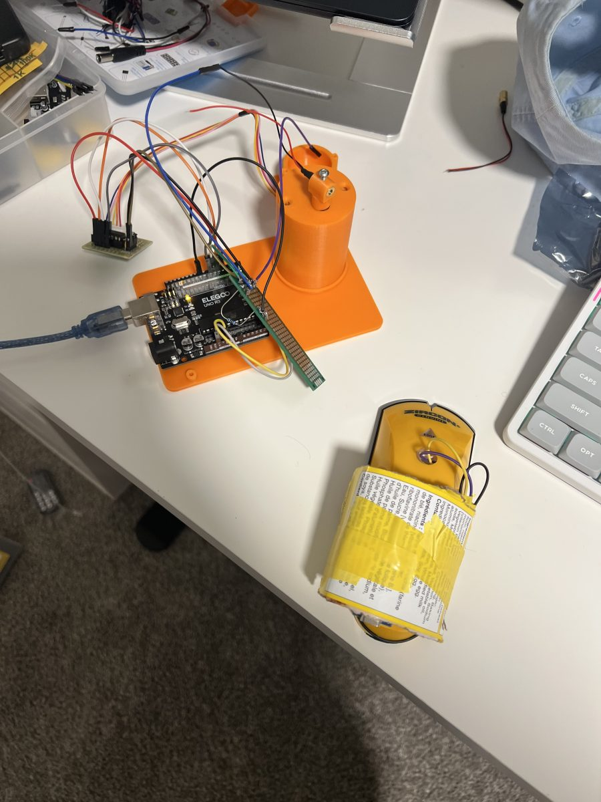
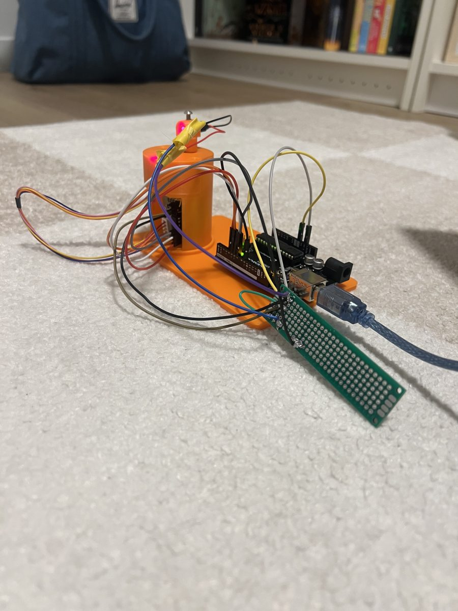
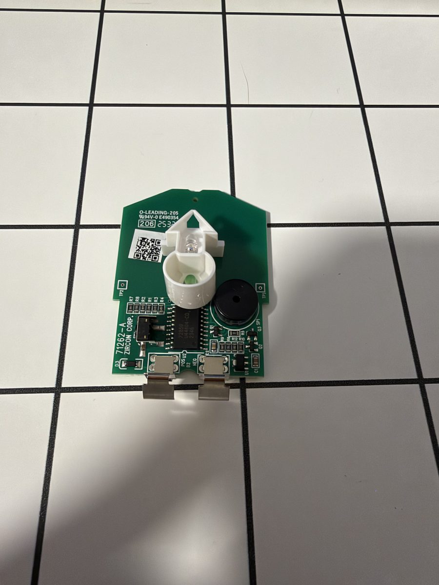
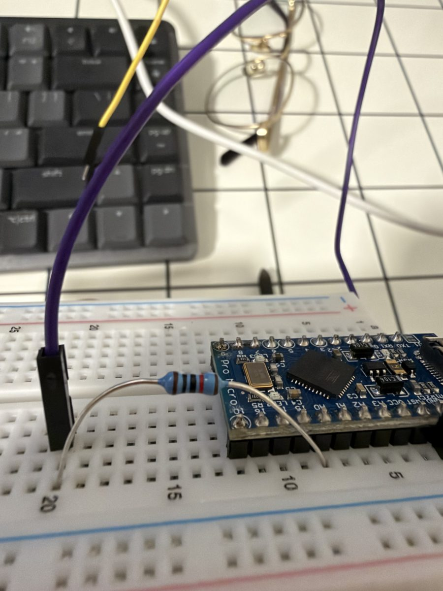
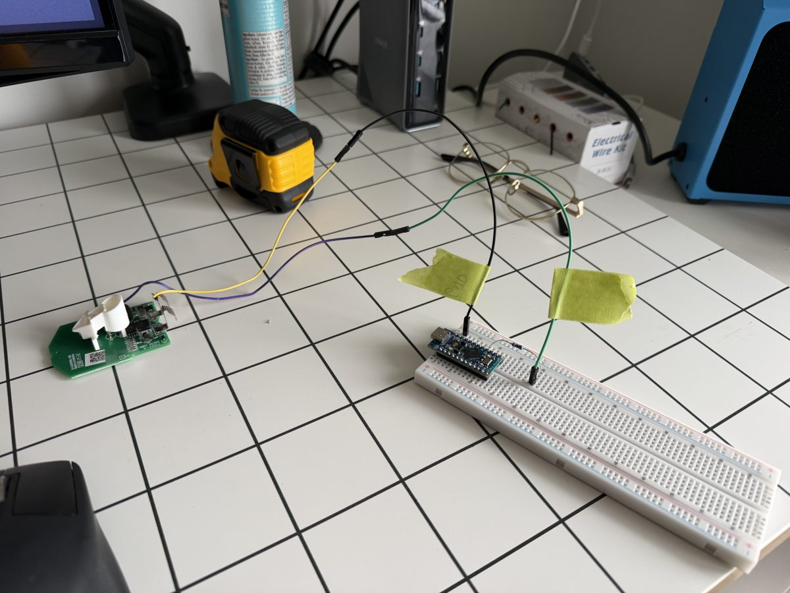

# Stud Finder Plus

Demo Video: https://www.youtube.com/watch?v=_jWns4CxalU

A $15 stud finder + Arduino + iPhone camera that maps every stud on a wall
and points a laser at each one as you find it.

The stud finder tells the laptop (over USB) every time its LED lights up. The
iPhone camera tracks where the stud finder is on the wall, so each stud gets a
real position in inches. A line laser on a stepper motor then marks the stud
on the actual wall.

<p align="center">
  
  
</p>

## What we used

### Hardware
| Part | What it's for |
|---|---|
| Zircon edge-finding stud finder (~$15, LED indicator, own 9V battery) | Detects the stud edges |
| Arduino Pro Micro (ATmega32U4, 5V/16 MHz) + breadboard | Reads the stud finder's LED and sends `S1`/`S0` over USB |
| 10kΩ resistor, jumper wires, solder, hot glue | Stud finder → Pro Micro |
| Elegoo Uno R3 (Nano/Mega/Pro Micro also work) | "Laser station": runs the motor and laser |
| 28BYJ-48 5V stepper + ULN2003 driver board | Turns the laser left/right |
| Red line laser module (vertical line), mounted on the motor shaft | Marks the stud on the wall |
| PN2222/2N2222 NPN transistor + 1kΩ resistor on perfboard | Switches the laser from a pin |
| 3D-printed base + motor tower | Holds the Uno, stepper and laser steady |
| 5V power module | Powers the driver + laser |
| iPhone + tripod + USB cable | Camera (macOS Continuity Camera) |
| MacBook | Runs everything |
| Demo wall: ½" drywall on 2×4s, drywall screws | Studs at uneven spacing, true centers marked on the back |
| Painter's tape, a bright non-red tag | 4 crosses around the scan area, tag on the stud finder for tracking |
| Desk lamp (optional) | Less motion blur |

### Software
- **Laptop:** Python 3, OpenCV (`opencv-contrib-python`), NumPy, pyserial
- **Web page:** React 18 + Vite, react-loaders / loaders.css
- **Firmware:** C++ (Arduino framework) built with PlatformIO, no Arduino IDE

## Wiring

**Stud finder → Pro Micro**

<p align="center">
  
  
  
</p>

- The pad behind the clear LED in the stud finder's arrow tip (reads ~3.1V)
  → 10kΩ → **A0**. The clear LED is the stud indicator, not the green one.
- Stud finder battery negative → Pro Micro **GND**
- Leave the other pad (5V) alone, and never wire the battery side (~8V) to a pin.
- Hot-glue the joints. A torn wire is the most likely demo failure.

**Laser station (Uno)**, see the photos at the top
- Pins 4, 5, 6, 7 → ULN2003 IN1–IN4
- Pin 9 → 1kΩ → transistor base; transistor switches the laser
- Driver board + laser powered from the 5V module, **all grounds joined**
- Point the laser roughly at the middle of the wall before plugging it in.
  Wherever it is at power-up becomes step 0.

## Setup (once)
```bash
python3 -m venv .venv && source .venv/bin/activate
pip install -r requirements.txt
cd host/web && npm install && npm run build && cd ../..
pio pkg install -g --platform atmelavr      # if PlatformIO says "Unknown platform 'atmelavr'"
```

Flash the boards:
```bash
pio run -t upload                                   # stud finder (repo root)
cd firmware/laser_station && pio run -e uno -t upload   # laser station
```

## Run
Plug in both boards and connect the iPhone (cable in, unlocked, on the tripod).
```bash
./start.sh                # finds both boards and opens http://localhost:8000
./start.sh --camera 1     # if it opened the Mac's camera instead of the iPhone
./start.sh --flash        # re-upload the stud finder firmware first
```
`start.sh` finds the Pro Micro and laser station by themselves and remembers
the ports in `host/ports.json`. Only one program can use a serial port, so
close any `pio device monitor` first.

No hardware? `python host/web.py --tape --fake-laser` simulates the laser and
lets Space stand in for the stud finder.

## Using it
The page walks you through 3 steps. You can click back to any step you've
already reached.

1. **Calibrate.** Enter the distance between the tape crosses, fit the box
   on the video to the 4 crosses (drag the corners, arrow keys nudge) and
   press Enter. Then press Space: the laser sweeps the wall so it learns where
   it points.
2. **Stud finder.** Click the colored tag on the stud finder in the video.
3. **Scan.** Hold the button with the finder flat on the wall, slide over a
   stud until the LED lights, then come at the same stud from the other side.
   The two edges become one stud on the map and the laser jumps to it.

**Restart setup** (top right, click twice) clears everything and starts over.

### Keys
| Key | Does |
|---|---|
| Space / Enter | Start the laser calibration (step 1) |
| Enter | Confirm the box; continue to the next step once one is done |
| Esc | Back a step |
| C | Redo the box |
| K | Recalibrate the laser |
| T | Pick the tag color again |
| N | Point the laser at the next stud |
| L | Laser on/off |
| R | Clear studs |
| Space (step 3, no Pro Micro) | Fake stud signal |

## When something doesn't work
- **Wrong camera / black video:** the iPhone isn't connected as a camera.
  Replug it with a data cable, unlock it, then restart. `python host/find_camera.py`
  shows which index is which. Turn off Center Stage and other Video Effects
  in Control Center, they crop the image and break the measurements.
- **Every run writes a log** to `host/logs/<date-time>/events.log`, plus
  snapshots of the camera whenever something fails. It has every serial line
  from both boards, what happened to each stud edge, and when the tracker or
  laser was lost. The path is under **Settings and log** on the page.
- See `agents.md` for which log lines to look for per problem.

## Settings
Top of `host/app.py`: `SENSOR_OFFSET_IN` (tag center → sensor, measure it),
`MAX_STUD_IN`, `MERGE_IN`, `LASER_MAX_STEPS`, `CAMERA_LATENCY_S`.

`--tape` (which `start.sh` uses) tracks a colored tag. Without it the app
tracks ArUco marker 10 (`python markers/gen_markers.py --show` makes them).

## Layout
- `host/app.py` core: tracking, stud map, steps, laser
- `host/web.py` web server, `host/web/` the React page
- `host/main.py` backup front end in an OpenCV window
- `host/vision.py` wall mapping + tag/marker tracking
- `host/laser.py` laser detection, calibration, aiming, `FakeRig` simulator
- `host/serial_link.py` serial ports, `host/diag.py` the debug log
- `firmware/src/` stud finder firmware (Pro Micro, `platformio.ini` at the repo root)
- `firmware/laser_station/` motor + laser firmware
- `markers/` ArUco markers

## Serial protocol (115200 baud, one line per message)
- **Stud finder → laptop:** `S1 <millis>` LED on (a stud edge), `S0 <millis>`
  LED off. Only `S1` is used: an edge found moving right pairs with one found
  moving left, up to 3.5" apart.
- **Laptop → laser station:** `G <steps>` go to, `Z` zero here, `L 1`/`L 0`
  laser, `P` position, `ID` → `ID LASER`. Replies `OK ...` / `ERR ...`.

### Stud finder A0 levels
What the Pro Micro reads on A0 (the firmware turns these into `S1`/`S0`):

| Reading | Meaning |
|---|---|
| ~1023 | On, no stud |
| ~720–736 | Stud |
| ~305 | Stud finder off |
| ~885 | Brief, at power-on (ignored) |
